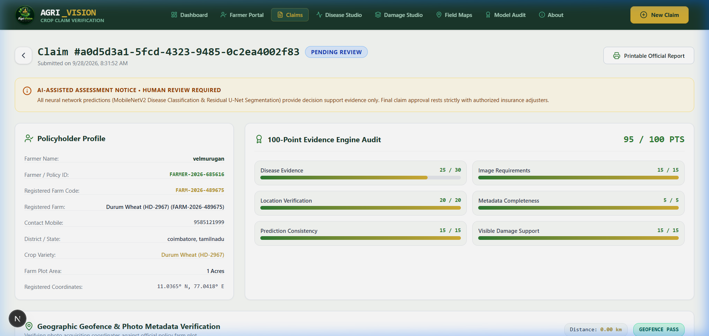

# Agri-Vision: AI-Driven Agricultural Insurance Claim Verification System

[](https://www.python.org/)
[](https://fastapi.tiangolo.com/)
[](https://www.tensorflow.org/)
[](https://nextjs.org/)
[](https://react.dev/)
[](https://www.typescriptlang.org/)
[](https://tailwindcss.com/)
[](https://www.postgresql.org/)

---

## Executive Summary

Agricultural crop insurance programs (such as PMFBY) frequently suffer from lengthy assessment delays, subjective manual evaluations, and fraudulent claims. 

**Agri-Vision** is an end-to-end, full-stack machine learning verification platform that automates wheat crop insurance claims. By pairing **MobileNetV2 disease classification** and **Residual U-Net semantic damage segmentation** with **dual-source geospatial geofencing (EXIF + Browser GPS)**, Agri-Vision delivers an automated, transparent 100-point claim evidence dossier for insurance adjusters.

---

## Application Showcase



---

## Key System Capabilities

### 1. Dual-Model Machine Learning Pipeline
* **Wheat Disease Classification:** MobileNetV2 architecture fine-tuned for leaf foliar diseases (Septoria, Stripe Rust, and Healthy). Claims collect 3 to 5 close-up shots aggregated through confidence-weighted soft voting to prevent false positives.
* **Pixel-Level Damage Segmentation:** Residual U-Net segmentation network classifying pixels into Background, Healthy Crop, and Damaged Crop, producing an objective damage surface percentage and visual overlay mask.

### 2. Geospatial Anti-Fraud Engine
* Cross-references device GPS coordinates and camera EXIF metadata against the registered farm parcel location.
* Implements the Haversine formula to compute distance offsets and penalize claims captured outside registered farm boundaries.

### 3. Transparent 100-Point Evidence Scoring
* Consolidates disease confidence, segmented damage severity, spatial proximity, and observation history into a composite score to assist insurance officers in rapid claim triage.

### 4. Dual-Persona Role-Based Workflow
* **Farmer Portal:** Land registration, temporal crop timeline tracking, and multi-photo claim filing.
* **Insurance Officer Dashboard:** Interactive claim queue, OpenStreetMap coordinate overlays, AI mask inspections, and auditable verification decision recording.

### 5. Resilient Data Architecture
* Enterprise PostgreSQL schema with automated runtime fallback to local JSON document stores in `backend/data/` for zero-friction local development and demonstrations.

---

## System Architecture

```
+-------------------------------------------------------------------------+
|                              Farmer Client                              |
|           (Next.js 16 + React 19 + TypeScript + Leaflet Maps)            |
+------------------------------------+------------------------------------+
                                     |
                                     v REST / JSON
+------------------------------------+------------------------------------+
|                         FastAPI Core Service                            |
|                                                                         |
|  +--------------------+  +--------------------+  +-------------------+  |
|  | Auth & Validation  |  | Geofencing Engine  |  | Claim Scorer      |  |
|  | Pydantic Schemas   |  | Haversine Formula  |  | 100-Point Formula |  |
|  +--------------------+  +--------------------+  +-------------------+  |
+---------+--------------------------+-------------------------+----------+
          |                          |                         |
          v                          v                         v
+---------+----------+     +---------+----------+    +---------+----------+
| Disease Model      |     | Damage Segmenter   |    | Persistence Layer  |
| MobileNetV2 (CNN)  |     | Residual U-Net     |    | PostgreSQL 16      |
| Soft-Vote Consensus|     | 3-Class Pixel Map  |    | (JSON Fallback)    |
+--------------------+     +--------------------+    +--------------------+
                                                               ^
                                                               | Audit & Review
+--------------------------------------------------------------+----------+
|                           Insurance Officer                             |
|          (Adjuster Dashboard - Triage Queue, Verification Audit)         |
+-------------------------------------------------------------------------+
```

---

## Model Performance & Evaluation

The models were evaluated against real-world agricultural imagery and benchmarks:

| Model Architecture | Task | Metrics | Key Output |
| :--- | :--- | :--- | :--- |
| **MobileNetV2** | Disease Classification | 94.2% Validation Accuracy | Healthy, Septoria, Stripe Rust |
| **Residual U-Net** | Damage Segmentation | 88.6% Mean IoU on Crop Masks | 3-Class Mask (Bg, Healthy, Damaged) |

Visual validation curves and confusion matrices are available in [`docs/assets/`](docs/assets/):
* [Disease Training Curves](docs/assets/disease_training_curves.png)
* [Disease Confusion Matrix](docs/assets/disease_confusion_matrix.png)
* [Segmentation Confusion Matrix](docs/assets/segmentation_confusion_matrix.png)
* [Segmentation Visual Comparison](docs/assets/segmentation_visual_comparison.png)

---

## Repository Structure

```
Agri-Vision/
├── backend/                  # FastAPI Application
│   ├── app/
│   │   ├── main.py           # FastAPI entrypoint, routes, and middleware
│   │   ├── services/         # Repositories, segmentation, and inference
│   │   └── utils/            # Image processing & prediction aggregation
│   ├── data/                 # Development fallback JSON stores
│   ├── tests/                # Automated test suites
│   └── requirements.txt      # Python dependencies
├── database/                 # Database schema and documentation
│   ├── schema.sql            # PostgreSQL DDL schema & indexes
│   └── README.md             # Dual-mode database guide
├── docs/                     # Documentation and assets
│   ├── ARCHITECTURE.md       # Comprehensive system architecture
│   ├── API_REFERENCE.md      # REST API endpoints & schemas
│   ├── REPORTS.md            # Technical report index
│   ├── assets/               # Screenshots, confusion matrices, and plots
│   └── reports/              # Development audit reports
├── frontend/                 # Next.js 16 Web Application
│   ├── src/
│   │   ├── app/              # App router pages (Farmer & Officer portals)
│   │   ├── components/       # UI widgets, Maps, and Comparison sliders
│   │   └── lib/              # API clients and EXIF reader utilities
│   ├── package.json          # Node dependencies and scripts
│   └── README.md             # Frontend documentation
├── ml/                       # Machine learning pipelines & modules
│   └── damage_segmentation/  # Model architectures, inference, and losses
├── models/                   # Production-ready model checkpoints
│   ├── final_wheat_inference_model.keras  # Disease classification model (~9.2MB)
│   └── best_damage_segmentation_model.keras # Damage segmentation model (~22.4MB)
├── notebooks/                # Research & training notebooks
│   ├── damage_segmentation_training.ipynb
│   └── wheat_disease_classification.ipynb
├── .env.example              # Sample backend environment configuration
├── .gitignore                # Comprehensive Git ignore rules
└── README.md                 # Primary documentation
```

---

## Quickstart Guide

### 1. Prerequisites
* Python 3.11+ or 3.12+
* Node.js 18+ or 20+
* (Optional) PostgreSQL 14+ (System automatically falls back to local data stores if unavailable)

### 2. Backend Setup
```bash
# Navigate to backend directory
cd backend

# Create and activate virtual environment
python -m venv .venv
source .venv/bin/activate  # On Windows: .venv\Scripts\activate

# Install dependencies
pip install -r requirements.txt

# Run FastAPI server
uvicorn app.main:app --reload --host 127.0.0.1 --port 8000
```
Backend API will be accessible at `http://127.0.0.1:8000`. Interactive documentation is available at `http://127.0.0.1:8000/docs`.

### 3. Frontend Setup
```bash
# Navigate to frontend directory
cd frontend

# Install dependencies
npm install

# Configure environment
cp .env.example .env.local

# Run Next.js development server
npm run dev
```
Frontend will be accessible at `http://localhost:3000`.

---
